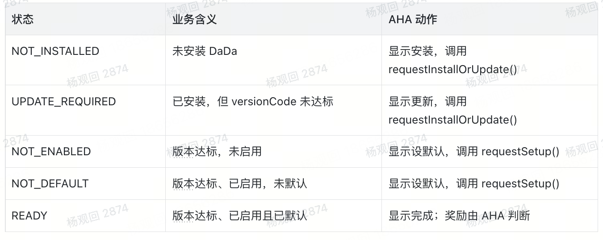

# AHA JS Bridge \- API接口文档

# AHA 5\.1\.48及以上支持

## 请求头相关参数

### headers

**调用协议：/api/headers**

**调用形式：同步**

**请求参数：**

**返回值：**

|返回值类型|说明|
|---|---|
|Object|```JSON<br>{<br>  "X-Country": "TH",<br>  "X-Language": "en",<br>  "X-OsVersion": "12",<br>  "X-PackageName": "net.bat.store",<br>  "X-VersionCode": "2777",<br>  "X-VersionName": "V5.1.49.8_debug",<br>  "X-CPU": "arm64-v8a,armeabi-v7a,armeabi",<br>  "X-GPU": "3.2",<br>  "X-Density": "480",<br>  "X-Model": "TECNO AD8",<br>  "X-Ram": "8",<br>  "X-Q": "bW9kZWw9VEVDTk8gQUQ4JmNwdT1hcm02NC12OGEsYXJtZWFiaS12N2EsYXJtZWFiaSZncHU9My4yJnJhbT04JmRlbnNpdHk9NDgw",<br>  "X-OS-GO": "0",<br>  "X-Gaid": "6c439008-b7aa-44e8-b2bc-67676ced96ef",<br>  "X-One-Id":"dc7f1996-42d4-3ea4-bc4c-64156596ab56"<br>}<br>```|

**调用示例：**

```JavaScript
try {
    const result = window.bridgeCore.callBridgeSync("/api/headers", {})
} catch (e) {
}
```


# AHA 5\.1\.49及以上支持

## 储存API（活动容器以及游戏容器均支持）

### 域名私有key\- value建值对映射

每个域名内单独key\- value映射表，各个域名数据互相独立

#### get

**调用协议：/storage/get**

**调用形式：同步**

**请求参数：**

|参数名称|参数值类型|
|---|---|
|key|String|

**返回值：**

|返回值类型|说明|
|---|---|
|String|存在null的可能|

**调用示例：**

```JavaScript
try {
    const result = window.bridgeCore.callBridgeSync("/storage/get", {
        "key":"key1"
    })
} catch (e) {
}
```

#### put

**调用协议：/storage/put**

**调用形式：同步**

**请求参数：**

|参数名称|参数值类型|
|---|---|
|key|String|
|value|String|

**返回值：**

|返回值类型|说明|
|---|---|
|String|如果是新增则返回null，否则返回被替换的旧值。|

**调用示例：**

```JavaScript
try {
    const result = window.bridgeCore.callBridgeSync("/storage/put", {
        "key":"key1",
        "value":"value1"
    })
} catch (e) {
}
```

#### remove

**调用协议：/storage/remove**

**调用形式：同步**

**请求参数：**

|参数名称|参数值类型|
|---|---|
|key|String|

**返回值：**

|返回值类型|说明|
|---|---|
|boolean|成功移除则返回true，否则返回false。|

**调用示例：**

```JavaScript
try {
    const result = window.bridgeCore.callBridgeSync("/storage/remove", {
        "key":"key1"
    })
} catch (e) {
}
```

### 可共享的key\- value建值对映射

通过flag标识进行建立公用的key\- value映射表，相同的flag标识数据互通

#### get

**调用协议：/storage/getPlus**

**调用形式：同步**

**请求参数：**

|参数名称|参数值类型|
|---|---|
|flag|String|
|key|String|

**返回值：**

|返回值类型|说明|
|---|---|
|String|存在null的可能|

**调用示例：**

```JavaScript
try {
    const result = window.bridgeCore.callBridgeSync("/storage/getPlus", {
        "flag":"flag1",
        "key":"key1"
    })
} catch (e) {
}
```

#### put

**调用协议：/storage/putPlus**

**调用形式：同步**

**请求参数：**

|参数名称|参数值类型|
|---|---|
|flag|String|
|key|String|
|value|String|

**返回值：**

|返回值类型|说明|
|---|---|
|String|如果是新增则返回null，否则返回被替换的旧值。|

**调用示例：**

```JavaScript
try {
    const result = window.bridgeCore.callBridgeSync("/storage/putPlus", {
        "flag":"flag1",
        "key":"key1",
        "value":"value1"
    })
} catch (e) {
}
```

#### remove

**调用协议：/storage/removePlus**

**调用形式：同步**

**请求参数：**

|参数名称|参数值类型|
|---|---|
|flag|String|
|key|String|

**返回值：**

|返回值类型|说明|
|---|---|
|boolean|成功移除则返回true，否则返回false。|

**调用示例：**

```JavaScript
try {
    const result = window.bridgeCore.callBridgeSync("/storage/removePlus", {
        "flag":"flag1",
        "key":"key1"
    })
} catch (e) {
}
```

## 路由

### 页面路由

**调用协议：/router/page**

**调用形式：同步**

**请求参数：**

|参数名称|参数值类型|
|---|---|
|url|String|

**返回值：**

|返回值类型|说明|
|---|---|
|boolean|跳转结果|

**调用示例：**

```JavaScript
try {
    const result = window.bridgeCore.callBridgeSync("/router/page", {
        "url":"aha://detail?appId=2411"
    })
} catch (e) {
}
```

## 监听

### 网络监听

**调用协议：/listener/net**

**调用形式：****异步**

**请求参数：无**

**返回值：**

|返回值类型|说明|net参数解析|
|---|---|---|
|JSON|\{"code":0,"message":"success","data":\{"net":1\}\}|\-1 : 网络不可用<br>1 : WIFI<br>0 : 移动网络<br>7 : 其他|

**调用示例：**

```JavaScript
try {
     window.bridgeCore.callBridge("/listener/net", {}, (result) => {
        if (result.code == 0) {
            const netState =result.data.net
        } else {
            const exceptionMessage = result.message
        }
    })
} catch (e) {
}
```

**调用协议：/listener/netSync**

**调用形式：****同步**

**请求参数：无**

**返回值：**

|返回值类型|说明|
|---|---|
|int|\-1 : 网络不可用<br>1 : WIFI<br>0 : 移动网络<br>7 : 其他|

**调用示例：**

```JavaScript
try {
    const result = window.bridgeCore.callBridgeSync("/listener/**netSync**", {})
} catch (e) {
}
```


## 状态

### 暗黑模式获取

**调用协议：/status/dark**

**调用形式：同步**

**请求参数：无**

**返回值：**

|返回值类型|说明|
|---|---|
|int<br>|1 ：正常状态<br>2 ：暗黑模式|

**调用示例：**

```JavaScript
try {
    const result = window.bridgeCore.callBridgeSync("/status/dark", {})
} catch (e) {
}
```

### 暗黑模式设置

## 工具

### 分享

**调用协议：/util/share**

**调用形式：同步**

**请求参数：**

|请求参数|说明|
|---|---|
|content|内容|
|title|标题|

**返回值：**

|返回值类型|说明|
|---|---|
|boolean<br>|True false 成功失败|

**调用示例：**

```JavaScript
try {
    const result = window.bridgeCore.callBridgeSync("/util/share", {"title":"I am title","content":"xxxxxx"})
} catch (e) {
}
```

### 分享2（可监听至对方界面）

**调用协议：/util/share2**

**调用形式：异步**

**请求参数：**

|请求参数|说明|
|---|---|
|content|内容|
|title|标题|

**返回值：**

|返回值类型|说明|
|---|---|
|JSON|\{"code":0,"message":"success","data":\{"result":"success"\}\}|

**调用示例：**

```JavaScript
try {
    const p = {
        content: "分享内容测试 ! ",
        title: "name"
    }
    window.bridgeCore.callBridge("/util/share2", p, (result) => {
        if (result.code == 0) {
            //success 
            document.getElementById("info").innerHTML = JSON.stringify(result)
        } else {
            //failure
            document.getElementById("info").innerHTML = JSON.stringify(result)
        }
    })
} catch (e) {
    //failure
    document.getElementById("info").innerHTML = e
}
```

### 复制

**调用协议：/util/copy**

**调用形式：同步**

**请求参数：**

|请求参数|说明|
|---|---|
|label|label|
|content|内容|

**返回值：**

|返回值类型|说明|
|---|---|
|boolean<br>|True false 成功失败|

**调用示例：**

```JavaScript
try {
    const result = window.bridgeCore.callBridgeSync("/util/copy", {"label":"label","content":"xxxxxx"})
} catch (e) {
}
```

**调用协议：/status/setForceDark**

**调用形式：****异步**

**请求参数：**

|请求参数|说明|
|---|---|
|dark|1:暗黑模式<br>2:正常模式|

**返回值：**

|返回值类型|说明|
|---|---|
|JSON|\{"code":0,"message":"success","data":true\}|

**调用示例：**

```JavaScript
try {
    window.bridgeCore.callBridge("/status/setForceDark", {
                            "dark":1
    }, (result) => {})
} catch (e) {Í
}
```

## 大转盘活动专用

### 打开奖品列表

**调用协议：/turntable/openList**

**调用形式：****异步**

**请求参数：**

**返回值：**

**调用示例：**

```JavaScript
try {
    window.bridgeCore.callBridge("/turntable/openList", {
    }, (result) => {})
} catch (e) {
}
```

### 打开地址编辑界面

**调用协议：/turntable/openObjectAddress**

**调用形式：****异步**

**请求参数：**

|请求参数|说明|
|---|---|
|id|活动id|
|icon|icon地址|
|name|名称|
|validTime|过期时间（ms）|

**返回值：**

**调用示例：**

```JavaScript
try {
    window.bridgeCore.callBridge("/turntable/openObjectAddress", {
        "id":21,
        "icon":"xxx",
        "name":"xxxx",
        "validTime":1734332976918
    }, (result) => {})
} catch (e) {
}
```

### 打开话费充值界面

**调用协议：/turntable/openPhoneCharge**

**调用形式：****异步**

**请求参数：**

|请求参数|说明|
|---|---|
|id|活动id|
|icon|icon地址|
|name|名称|
|validTime|过期时间（ms）|

**返回值：**

**调用示例：**

```JavaScript
try {
    window.bridgeCore.callBridge("/turntable/openPhoneCharge", {
        "id":21,
        "icon":"xxx",
        "name":"xxxx",
        "validTime":1734332976918
    }, (result) => {})
} catch (e) {
}
```

## 数据库

### 查询游戏游玩时长（按照时间间隔查询）

**调用协议：/db/searchGamePlayDur**

**调用形式：****异步**

**请求参数：**

|参数名称|参数类型|说明|
|---|---|---|
|gameId<br>|int|游戏id|
|startT|long|查询开始时间戳 ms|
|endT|long|查询结束时间戳 ms|

**返回值：**

|返回值类型|说明|状态说明|
|---|---|---|
|JSON|\{"code":0,"message":"success","data":15647\}|data 里面是所需的字段参数<br>直接返回游玩时间戳<br>|

**调用示例：**

```JavaScript
// 获取当前时间
const now = new Date();
// 获取当前时间戳（毫秒）
const currentTimestamp = now.getTime();
// 获取今天0点的时间
const todayMidnight = new Date(now.getFullYear(), now.getMonth(), now.getDate());
// 获取今天0点的时间戳（毫秒）
const midnightTimestamp = todayMidnight.getTime();

try {
    const result = window.bridgeCore.callBridge("/db/searchGamePlayDur", {
        "gameId": 91301, "startT": midnightTimestamp, "endT": currentTimestamp
    }, (result) => {
        if (result.code == 0) {
            const dur = result.data
            console.log('游戏 91301 的时长为 ' + dur + 'ms .')
        } else {
            const exceptionMessage = result.message
        }
    })
} catch (e) {
}
```

### 查询游戏play次数（按照时间间隔查询）

**调用协议：/db/searchGameCount**

**调用形式：****异步**

**请求参数：**

|参数名称|参数类型|说明|
|---|---|---|
|gameId<br>|int|游戏id|
|startT|long|查询开始时间戳 ms|
|endT|long|查询结束时间戳 ms|

**返回值：**

|返回值类型|说明|状态说明|
|---|---|---|
|JSON|\{"code":0,"message":"success","data":2\}|data 里面是所需的字段参数<br>直接返回游玩次数<br>|

**调用示例：**

```JavaScript
// 获取当前时间
const now = new Date();
// 获取当前时间戳（毫秒）
const currentTimestamp = now.getTime();
// 获取今天0点的时间
const todayMidnight = new Date(now.getFullYear(), now.getMonth(), now.getDate());
// 获取今天0点的时间戳（毫秒）
const midnightTimestamp = todayMidnight.getTime();

try {
    const result = window.bridgeCore.callBridge("/db/searchGameCount", {
        "gameId": 91311, "startT": midnightTimestamp, "endT": currentTimestamp
    }, (result) => {
        if (result.code == 0) {
            const count = result.data
            console.log('游戏 91311 的play次数为 ' + count + ' .')
        } else {
            const exceptionMessage = result.message
        }
    })
} catch (e) {
}
```

## Auth2授权

### authCode

**调用协议：/auth/authCode**

**调用形式：****异步**

**请求参数：**

|参数名称|参数值类型|
|---|---|
|appId|String|

**返回值：**

|返回值类型|说明|
|---|---|
|JSON|\{"code":0,"message":"success","data":\{"authCode":"xxxxxxx"\}\}|

**调用示例：**

```JavaScript
try {
    window.bridgeCore.callBridge("/auth/authCode", {appId:"xxxxxxxx"}, (result) => {
        if (result.code == 0) {
            const netState =result.data.authCode
        } else {
            const exceptionMessage = result.message
        }
    })
} catch (e) {
}
```

## 页面关闭

### finish

**调用协议：/lifecycle/finish**

**调用形式：****异步**

**请求参数：**

|参数名称|参数值类型|
|---|---|
|appId|String|

**返回值：**

|返回值类型|说明|
|---|---|
|JSON|\{"code":0,"message":"success","data":true\}|

**调用示例：**

```JavaScript
try {
    window.bridgeCore.callBridge("/lifecycle/finish", {}, (result) => {})
} catch (e) {
}
```

## 页面生命周期监听

**调用协议：/lifecycle/activity**

**调用形式：****异步**

**请求参数：**

**返回值：**

|返回值类型|说明|状态说明|
|---|---|---|
|JSON|\{"code":0,"message":"success","data":\{"status":0\}\}|**0**:OnCreate<br>**1**:OnStart<br>**2**:OnResume<br>**3**:OnPause<br>**4**:OnStop<br>**5**:OnDestory|

**调用示例：\(****附带监听页面刷新逻辑****\)**

```JavaScript
try {
    let lastStatus = -1
    window.bridgeCore.callBridge("/lifecycle/activity", {}, (result) => {
        if (result.code == 0) {
            const status =result.data.status
            
            if (status <= 1){
                return;
            }
            
            if (lastStatus >= 3 && status = 2){
                //todo  刷新
            }
            
            lastStatus = status;
            
        } else {
            const exceptionMessage = result.message
        }
    })
} catch (e) {
}
```

## 埋点\-AHA规则埋点

**调用协议：/event/sendNew**

**调用形式：****同步**

**请求参数：**

|参数名称|参数值类型\(json\)||
|---|---|---|
||String|\{"action":"show","elementStructs":\[\{"level":5,"position":null,"style":null,"type":"page"\},\{"level":10,"name":null,"type":"feedback"\},\{"level":15,"name":"feedback","type":"page"\},\{"level":20,"name":"feedback","type":"module"\}\]\}|

**返回值：无**

```JSON
try {
    const result = window.bridgeCore.callBridgeSync("/event/sendNew", {value:'',...})
} catch (e) {
}
```

## 横幅广告

**调用协议：**/ad/showBanner

**调用形式：**同步 （**注：异步调用请参见 **[AHA Bridge \- API接口文档](https://transsioner.feishu.cn/docx/NZ7Fd0KkOowcipx6MxQc2arPn3b#share-YbIjddOkroXRGyx7Sn6crkZOnud)**）**

**请求参数：**

```JSON
{"appKey":"1234"}
```

**响应：**无

**示例：**

```JavaScript
window.bridgeCore.callBridgeSync("/ad/showBanner", {"appKey":"1234"})
```

## 插屏广告

**调用协议：**/ad/adBreak

**调用形式：**异步

**请求参数：**

|请求字段|字段类型|字段说明|是否必传|示例|
|---|---|---|---|---|
|appKey|String|游戏标识|是|12345|
|type|String<br>|需要展示的广告类型，支持：<br>start, pause, next, browse,<br>reward（在aha6\.1\.8版本及以上支持）。<br>start, pause, next, browse均出插屏广告，reward出激励广告|是|next , reward |
|name|String|游戏场景|否||
|timeout|long|最长等待广告请求时长，单位ms|否|2000|

**异步响应：**

模拟adsense回调流程（https://developers\.google\.com/ad\-placement/apis?hl=zh\-cn）

|响应字段|字段类型|字段值|字段值说明|
|---|---|---|---|
|code|int|1|beforeAd|
|||2|afterAd|
|||3|adBreakDone|
|||4|beforeReward|
|||5|adDismissed|
|||6|adViewed|
|data<br>|obj|\{adShowToken:"1435234249470"\}|数据对象<br>|
|data\.adShowToken<br>|String|1435234249470|当回调是beforeReward时，将会一并返回广告展示凭证，用于后续调用/ad/showAdFn作为请求参数|

**示例：**

```JavaScript
window.bridgeCore.callBridge("/ad/adBreak", {
    appKey: “12345”,
    type: “reward”,
    name: "aaa",
    timeout: 2000
}, (result) => {
    if (result.code === 1) {
        //beforeAd回调
    } else if (result.code === 2) {
        //afterAd回调
    } else if (result.code === 3) {
        //adBreakDone回调
    } else if (result.code === 4) {
        //beforeReward回调
        
        //广告展示凭证
        const adShowToken=result.data.adShowToken
        
    } else if (result.code === 5) {
        //adDismissed回调
    } else if (result.code === 6) {
        //adViewed回调
    }
})
```

## 展示激励广告\( \>= 6\.1\.8 \)

**调用协议**：/ad/showAdFn

**调用形式**：异步

**请求参数**：

```JSON
{"adShowToken":"1435234249470"}
```

**响应**：无

**示例**：

```JavaScript
window.bridgeCore.callBridge("/ad/showAdFn", {"adShowToken":"1435234249470"})
```

# AHA 6\.1\.2及以上支持

## AHA代理上报埋点

**调用协议：/event/proxySend**

**调用形式：****同步**

**请求参数：**

|参数名称|参数类型|参数说明|示例|
|---|---|---|---|
|eventName|String|事件名称|pubsite\_click|
|eventId|long|appId|7842、1061|
|eventData|String|事件数据<br>|\{"eventName":"pubsite\_click","eventId":7842,"eventData":"\{\\"pubsite\_data\\":\\"2\\",\\"app\_version\\":\\"V5\.1\.50\.8\\",\\"gaid\\":\\"53cb3148\-63b6\-4e5d\-a527\-312803ebba07\\",\\"action\\":\\"system\_return\_click\\",\\"scenario\\":\\"landpage\\",\\"advertiser\_id\\":\\"2147\\",\\"activity\_id\\":12859,\\"source\\":\\"\\",\\"position\\":\\"\\",\\"vuid\\":\\"V761436579117275alifk\\",\\"suid\\":\\"\\",\\"aid\\":\\"1db3d7d8\-b400\-0371\-707b\-216fe2d3f1c905625\\",\\"event\_ts\\":\\"1699571476810\\",\\"ts\\":1699571476847\}"\}|
|expandData<br>（AHA6\.1\.3及以上版本支持）<br>|Boolean|是否将事件展开至eparam<br>默认不展开<br>如果不展开或展开失败，则在eparam，多套一层js\_data字段；<br>如果展开，则直接报在eparam参数里<br>最多展开一层，存在对象或数组嵌套时，直接json化，放至对应字段下|true|

**返回值：无**

```JavaScript
let eventData={"pubsite_data":"2","app_version":"V5.1.50.8","gaid":"53cb3148-63b6-4e5d-a527-312803ebba07","action":"system_return_click","scenario":"landpage","advertiser_id":"2147","activity_id":12859,"source":"","position":"","vuid":"V761436579117275alifk","suid":"","aid":"1db3d7d8-b400-0371-707b-216fe2d3f1c905625","event_ts":"1699571476810","ts":1699571476847}
let param={"eventName":"pubsite_click","eventId":7842,"eventData":JSON.stringify(eventData)}
window.bridgeCore.callBridgeSync("/event/proxySend", param)
```

## 注册在页面退出时统计时长

**调用协议：/event/regPageDurTime**

**调用形式：****同步**

**请求参数：**

|参数名称|参数类型|参数说明|示例|
|---|---|---|---|
|eventName|String|事件名称|web\_stay|
|eventId|long|事件Id|7842、10617001|
|eventData|String|事件数据|\{"eventName":"web\_stay" , "eventId":7842 , "pickDatas":\[1\] , "eventData":"\{\\"ts\\":1699571827585,\\"dur\\":3000,\\"type\\":\\"heartbeat\\",\\"ext\\":\\"\\"\}"\}|
|pickDatas|array int<br>|需要由AHA帮助采集的数据集：<br>1 = 时长|\[1\]<br>|
|expandData<br>（AHA6\.1\.3及以上版本支持）|Boolean|是否将事件展开至eparam<br>默认不展开<br>如果不展开或展开失败，则在eparam，多套一层js\_data字段；<br>如果展开，则直接报在eparam参数里<br>最多展开一层，存在对象或数组嵌套时，直接json化，放至对应字段下|false|

**返回值：无**

```JavaScript
let eventData={"ts":1699571827585,"dur":3000,"type":"heartbeat","ext":""}
let param={"eventName":"web_stay" , "eventId":7842 , "pickDatas":[1] , "eventData":JSON.stringify(eventData)}
window.bridgeCore.callBridgeSync("/event/regPageDurTime", param)
```

## 基础信息就获取

**调用协议：/business/basicInfo**

**调用形式：****同步**

**请求参数：**

|请求参数|说明|
|---|---|
|request|\["avatar","nickname","gender"\]|

**返回值：**

|返回值类型|说明|
|---|---|
|JsonObject<br>|\{"avatar":"xxx","nickname":"xxx","gender":0\}<br>|

**调用示例：**

```JavaScript
try {
    const result = window.bridgeCore.callBridgeSync("/business/basicInfo", {request:["avatar","nickname","gender"]})
} catch (e) {
}
```

## 小组件创建

**调用协议：/business/widgetState**

**调用形式：****同步**

**请求参数：**

|请求参数|说明|
|---|---|
|scence|1\(目前固定传1，以后可扩展别的场景\)|

**返回值：**

|返回值类型|说明|
|---|---|
|int<br>|1 ：已创建<br>2 ：未创建|

**调用示例：**

```JavaScript
try {
    const result = window.bridgeCore.callBridgeSync("/business/widgetState", {"scence":1})
} catch (e) {
}
```

**调用协议：/business/widgetCreate**

**调用形式：****同步**

**请求参数：**

|请求参数|说明|
|---|---|
|scence|1\(目前固定传1，以后可扩展别的场景\)|

**调用示例：**

```JavaScript
try {
    window.bridgeCore.callBridgeSync("/business/widgetCreate", {"scence":1})
} catch (e) {
}
```

## 获取会话环境

**调用协议：/session/env**

**调用形式：****同步**

**返回值：**

|参数名称|参数类型|参数说明|示例|
|---|---|---|---|
|reqTime|long|请求构建宿主的时间，一般指用户点击入口或者触发入口马上要开始创建宿主的时间，值是当前手机时间戳，单位ms|1700664358929|
|createTime|long|宿主创建时间，值是当前手机时间戳，单位ms|1700664358949|
|loadStartTime|long|宿主开始加载网页地址的时间|1700664358953|
|fShowTime|long|宿主首次曝光给用户的时间（可能是空白页、可能是loading页，可能是加载完成的页），如果未走到曝光阶段，则没有这个字段，值是当前手机时间戳，单位ms|1700664358934|
|latestShowTime|long|用户可能暂时切出这个宿主，等会又回来，表示最近一次切入的时间，如果未走到曝光阶段，则没有这个字段，值是当前手机时间戳，单位ms|1700664358934|
|loadEndTime|long|宿主加载网页结束的时间，可能加载失败可能加载成功，值是当前手机时间戳，单位ms|1700664358956|
|hostState<br>|int|0：创建阶段；1：启动阶段；2：曝光阶段；3：暂停阶段（上面有弹窗）；4：停止阶段（完全不可见，但用户可能过会又切回来）；5：已销毁|1|

```JavaScript
try{
let result=window.bridgeCore.callBridgeSync("/session/env", {})
} catch (e) {
}
let reqTime=result.reqTime
let createTime=result.createTime
```

# AHA 6\.1\.12 及以上支持

## 用户是否应该屏蔽广告（注意：目前只用于游戏内插屏广告）

**调用协议：/ad/shouldShieldAdForUser**

**调用形式：同步**

**请求参数：无**

**返回值：**

|返回值类型|说明|
|---|---|
|boolean|true 表示屏蔽<br>false 表示不屏蔽|

**调用示例：**

```JavaScript

 try {
  let shouldShieldAd = window.bridgeCore.callBridgeSync("**/ad/shouldShieldAdForUser**", {})
     } catch (e) {
}
```


# AHA 6\.1\.14 及以上支持

## 横幅广告支持回调

**调用协议：**/ad/showBanner

**调用形式：异步**

**请求参数：**

```JSON
{"appKey":"1234"}
```

**响应：**

|返回值类型|说明|状态说明|
|---|---|---|
|JSON|\{"code":0,<br>"message":"success"<br>\}<br>|code 值：<br>0: 展示成功<br>1: *展示失败：加载广告失败*<br>2: *展示失败：当前的状态不需要展示，比如正在展示中*<br>|

**示例：**

```JavaScript
try {
    window.bridgeCore.callBridge("/ad/showBanner", {"appKey":"1234"}, (result) => {
        if (result.code == 0) {
            // 展示成功
        } else {
            // 展示失败
        }
    })
} catch (e) {
}
```

# AHA **6\.1\.19\.0**及以上支持

## 游戏complete回调

**调用协议：/load/jsLoadProgress**

**调用形式：同步**

**请求参数：**

|请求参数|说明|
|---|---|
|node|gameLoadingCompleted<br><br>//自定义<br>|
|tmp|时间戳（ms）|

**返回值：**

|返回值类型|说明|
|---|---|
|boolean|true 表示成功<br>false 表示失败|

**调用示例：**

```JavaScript
try{
     let shouldShieldAd = window.bridgeCore.callBridgeSync("**/load/jsLoadProgress**", {
         "node":"",
         "tmp":138465464
     })
 }catch(e){
 }
```


# AHA  6\.1\.25\.0  及以上支持

## 客户端广告关闭事件监听

**调用协议：**/ad/closeEventObserver

**调用形式：异步**

**请求参数：**

```JSON
{"appKey":"1234"}
```

**响应：**

|返回值类型|说明|状态说明|
|---|---|---|
|JSON|\{"code":0\}<br>|code 值：<br>0: 关闭底部 Banner<br>|

**示例：**

```JavaScript
try {
    window.bridgeCore.callBridge("/ad/closeEventObserver", {"appKey":"1234"}, (result) => {
        if (result.code == 0) {
            // 关闭游戏底部 banner
        } else {
            //
        }
    })
} catch (e) {
}
```


---

PVP对战接口

# AHA   6\.1\.30\.0 及以上支持

## 获取对战信息

**调用协议：/pvp/getRoomInfo**

**调用形式：同步**

**请求参数：\(无\)**

**返回值：**

|返回值类型|说明|补充|
|---|---|---|
|JSON|\{<br>"toast": "",<br>"status": 3,<br>"roomId": "r\_7dc4b4d3\-e15d\-475d\-a3ed\-2bb986921ac1",<br>"matchId": "m\_88df9604\-8367\-4b18\-a685\-a210dd32bc65",<br>"countDown": 0,<br>"winnerPoints": 100,<br>"language":"en",<br>"players": \[\{<br>"uid": 460004445,<br>"nickname": "A42024087482",<br>"avatarId": 1,<br>"birthday": 0,<br>"gender": 0,<br>"avatar": "",<br>"winCount": 0,<br>"winRate": ""<br>\},<br>\{<br>"uid": 460001842,<br>"nickname": "RushKen",<br>"avatarId": 1,<br>"birthday": 694224000000,<br>"gender": 1,<br>"avatar": "https://tstatic\.ahagamecenter\.com/resource/robot/avatar/RushKen1731384462\.jpg",<br>"winCount": 0,<br>"level": "easy",// 机器人难度  easy normal <br>"winRate": ""<br>\}\]<br>\}|匹配成功数据透传<br>|

**调用示例：**

```JavaScript
try{
     let roomInfo = window.bridgeCore.callBridgeSync("**/pvp/getRoomInfo**",{})
 }catch(e){
 }
```


## 游戏结算

**调用协议：/pvp/gameOver**

**调用形式：同步**

**请求参数：**

|请求参数|说明|举例|其他说明|
|---|---|---|---|
|result|json转成字符串<br>|\[<br>\{<br>"uid": 12333,       // 用户ID<br>"hasTrustee": true,    // 是否被机器人托管过 true \- 是 ， false \- 否<br>"isWin": 1,         // 真正玩家（非机器人）是否胜利，1\- 胜利 ， 0 \- 失败<br>"robotTrustee": \{  // 委托机器人对象<br>"isWin": 1,  // 机器人是否胜利，1\- 胜利 ， 0 \- 失败<br>"type": 1,   // 托管类型，1、用户主动离开，机器人托管；<br>//         2、用户被动离开，机器人托管；<br>//         3、用户在游戏中，无操作，机器人托管；<br>\}<br>\},<br>\{<br>"uid": 33333,     // 用户ID<br>"hasTrustee": true,  // 是否被托管过 true \- 是 ， false \- 否<br>"isWin": 0,       // 真正玩家（非机器人）是否胜利，1\- 胜利 ， 0 \- 失败<br>"robotTrustee": \{ // 委托机器人对象<br>"isWin": 1,   // 真正玩家（非机器人）是否胜利，1\- 胜利 ， 0 \- 失败<br>"type": 1,    // 托管类型（同上）<br>\}<br>\}<br>\]|如果result数组长度\<2，则为异常逻辑，走异常处理逻辑|

**返回值：**

|返回值类型|说明|
|---|---|
|boolean|true 表示成功<br>false 表示失败|

**调用示例：**

```JavaScript
try{
     let gameOverResult = window.bridgeCore.callBridgeSync("**/pvp/gameOver**",{result:JSON.stringify([
        {
            "uid": 12333,       // 用户ID
            "hasTrustee": true,    // 是否被机器人托管过 true - 是 ， false - 否
            "isWin": 1,         // 真正玩家（非机器人）是否胜利，1- 胜利 ， 0 - 失败
            "robotTrustee": {  // 委托机器人对象
                "isWin": 1,  // 机器人是否胜利，1- 胜利 ， 0 - 失败
                "type": 1,   // 托管类型，1、用户主动离开，机器人托管；
                             //         2、用户被动离开，机器人托管；
                             //         3、用户在游戏中，无操作，机器人托管；
            }
        },
        {
            "uid": 33333,     // 用户ID
            "hasTrustee": true,    // 是否被机器人托管过 true - 是 ， false - 否
            "isWin": 0,       // 真正玩家（非机器人）是否胜利，1- 胜利 ， 0 - 失败
            "robotTrustee": { // 委托机器人对象
                "isWin": 1,   // 真正玩家（非机器人）是否胜利，1- 胜利 ， 0 - 失败
                "type": 1,    // 托管类型（同上）
            }
        }
      ])})
 }catch(e){
 }
```


## 游戏返回

**调用协议：/pvp/back**

**调用形式：同步**

**请求参数：\(无\)**

**返回值：**

|返回值类型|说明|
|---|---|
|boolean|true 表示成功<br>false 表示失败|

**调用示例：**

```JavaScript
try{
     let gameOverResult = window.bridgeCore.callBridgeSync("**/pvp/back**",{})
 }catch(e){
 }
```


## 点击用户头像弹框

**调用协议：/pvp/showUserInfoDialog**

**调用形式：同步**

**请求参数：**

|请求参数|说明|举例|
|---|---|---|
|uid|int<br>|点击头像的uid|

**返回值：**

|返回值类型|说明|
|---|---|
|boolean|true 表示成功<br>false 表示失败|

**调用示例：**

```JavaScript
try{
     let result = window.bridgeCore.callBridgeSync("**/pvp/showUserInfoDialog**",{uid:111})
 }catch(e){
 }
```

# 

## 注册pvp客户端回调接口

**调用协议：/pvp/registerCallback**

**调用形式：****异步**

**请求参数：**

**返回值：**

|返回值类型|说明|状态说明|
|---|---|---|
|JSON|\{"code":0,"message":"success","data":\{"method":"\*\*"\}\}<br>|method为调用的方法名称：<br>method=<br>playAgain    //再玩一次 playAgain有个matchId参数<br>backConfirm  //点击返回键，h5弹框确认<br><br>|

**调用示例：**

```JavaScript
try {
    let lastStatus = -1
    window.bridgeCore.callBridge("**/pvp/registerCallback**", {}, (result) => {
        if (result.code == 0) {
            const method =result.data.method
            
        } else {
            const exceptionMessage = result.message
        }
    })
} catch (e) {
}
```


## 传递用户avatar XY

**调用协议：/pvp/sendAvatartXY**

**调用形式：同步**

**请求参数：**

|请求参数|说明|举例|
|---|---|---|
|result|json<br>|\{<br>"gameWindow":\{<br>"width":xx,<br>"height":xx<br>\},<br>"emojiLocation":\{<br>"x":0,<br>"y":100<br>\},<br>" popLocation":\[ \{<br>"uid": 12333,      "x":0,<br>"y":100,<br>"style":2\},\{<br>"uid": 12333,        <br>"x":110,<br>"y":100,<br>"style":4\}\]<br>\}<br>//style表示pop弹框的样式<br>[AHA PVP对战游戏表情弹框style说明](https://transsioner.feishu.cn/docx/OCC0d2nYMo371DxoLZ2cEVFEngc)<br>Ludo 这边写死 2，4<br>|

**返回值：**

|返回值类型|说明|
|---|---|
|boolean|true 表示成功<br>false 表示失败|

**调用示例：**

```JavaScript
try{
     let result = window.bridgeCore.callBridgeSync("**/pvp/sendAvatartXY**",{result:{
        "emojiLocation":{
             "x":0,
             "y":100
        },
        " popLocation":[ {
                    "uid": 12333,      
                    "x":0,
                    "y":100,
                    "style":1},{
                    "uid": 12333,        
                    "x":110,
                    "y":100,
                    "style":2}
        ]
})
 }catch(e){
 }
```


## 游戏支持上报输赢以及分数

**调用协议：/gameAbility/reportGamePointsOrGameResult**

**调用形式：异步**

**请求参数：**

|请求参数|类型|说明|
|---|---|---|
|resultType|int|*1:赢 2：平 3：败  其他无效 如果该游戏不传递输赢建议传0*|
|points|int|*大于0 表明当前游戏游玩产生有效的分数 其他无效不上报  如果该游戏不传递输赢建议传0*|

**返回值：**

|返回值类型|说明|status说明|message说明|
|---|---|---|---|
|JSON|\{"code":0,"message":"success","data":\{"status":0,"message":"success"\}<br>\}|**1**:上报成功<br>**2**:上报失败|成功success<br>如果失败则显示失败原因|

**调用示例：**

```JavaScript
try {
    let lastStatus = -1
    window.bridgeCore.callBridge("/gameAbility/reportGamePointsOrGameResult", {resultType:0,points:100}, (result) => {
        if (result.code == 0) {
            const status =result.data.status
            const message =result.data.message
        } else {
            const exceptionMessage = result.message
        }
    })
} catch (e) {
}
```


# AHA   （6\.1\.31\.0） 版本支持

## 游戏加载完毕 \(Offline Game 专有\)

**调用协议：/gameAbility/gameLoadProgress**

**调用形式：同步**

**请求参数：**

|请求参数|类型|说明|
|---|---|---|
|progress<br>|int|*0 \- 100*<br>客户端仅认为大于等于100的时候算加载完成|

**返回值：**

|返回值类型|说明|
|---|---|
|boolean|true 表示成功<br>false 表示失败|

**调用示例：**

```JavaScript
try{
     let result = window.bridgeCore.callBridgeSync("**/gameAbility/gameLoadProgress**",{"progress":100})
 }catch(e){
 }
```

## 注册客户端游戏回调接口

**调用协议：/game/registerCallback**

**调用形式：****异步**

**请求参数：**

**返回值：**

|返回值类型|说明|状态说明|
|---|---|---|
|JSON|\{"code":0,<br>"message":"success",<br>"data":\{"method":"\*\*"\}<br>\}<br>|method 为调用的方法名称：<br>method=<br>pause     //游戏暂停<br>continue  //游戏继续<br><br>|

**调用示例：**

```JavaScript
try {
    window.bridgeCore.callBridge("**/game/registerCallback**", {}, (result) => {
        if (result.code == 0) {
            const method =result.data.method
        } else {
            const exceptionMessage = result.message
        }
    })
} catch (e) {
}
```


---

AHA游戏存储接口

# AHA（6\.1\.33\.0）及以上支持

## 关闭/显示游戏右上角的胶囊

**调用协议：**/ad/toggleGameExitCapsuleShow

**调用形式：**同步 

**请求参数：**

```JSON
{"action": "show"}  或  {"action": "hide"}
```

**响应：**无

**示例：**

```JavaScript
window.bridgeCore.callBridgeSync("/ad/toggleGameExitCapsuleShow", {"action": "show"})
```

# AHA   （6\.1\.34\.0）及以上支持

## 写游戏记录

**调用协议：/gameStorage/writeGameRecord**

**调用形式：****异步**

**请求参数：**

|请求参数|说明|举例|
|---|---|---|
|record|json<br>|\{<br>    mode: 'level',//模式 level 关卡，progress 进度 ，<br>    level: 2, // 关卡数<br>    contentJson: '\{"coin":999,"dress":"vip dress up","reward":true,"Attendance":false\}' //具体游戏存储数据<br>\}<br>|

**返回值：**

```Java
try{
    window.bridgeCore.callBridge("**/gameStorage/writeGameRecord**",{record:{
            mode: 'level',
            level: 2, 
            contentJson: '{"coin":999,"dress":"vip dress up","reward":true,"Attendance":false}' 
        },(result) => {
        if (result.code == 0) {
            const method =result.data.method
        } else {
            const exceptionMessage = result.message
        }
    }
 }catch(e){
 }
```


## 读游戏记录

**调用协议：/gameStorage/readGameRecord**

**调用形式：****异步**

**请求参数：\(无\)**

**返回值：**

|返回值类型|说明|
|---|---|
|JSON|\{"code":0,"message":"success","data":\{<br>    mode: 'level',//模式 level 关卡，progress 进度<br>    level: 2, // 关卡数<br>    contentJson: '\{"coin":999,"dress":"vip dress up","reward":true,"Attendance":false\}' //具体游戏存储数据<br>\}<br>\}|

```javascript
try{
    window.bridgeCore.callBridge("**/gameStorage/readGameRecord**",{},(result) => {
        if (result.code == 0) {
        } else {
        }
    }
 }catch(e){
 }
```

## 域名获取

**调用协议：/api/apiHost**

**调用形式：同步**

**请求参数：无**

**返回值：**

|返回值类型|说明|
|---|---|
|String<br>|域名|

**调用示例：**

```JavaScript
try {
    const result = window.bridgeCore.callBridgeSync("/api/apiHost", {})
    // https://tapi.ahagamecenter.com/
} catch (e) {
}
```


# AHA   （6\.1\.42\.0）及以上支持

## 获取游戏相关信息

**调用协议：/gameInfo/info**

**调用形式：****同步**

**返回值：**

|参数名称|参数类型|参数说明|示例|
|---|---|---|---|
|gameId|int|游戏id|60123|
|orientation|int|横竖屏；0 横屏 ， 1 竖屏。|0|
|installZipUpdatedAt|long|*本地已安装的版本号。如果没有则返回\-1**；*|1740647558|
|newUpdatedAt|long|云端下发的最新版本号。如果没有则返回\-1；|1740647523|


```JavaScript
try{
let result=window.bridgeCore.callBridgeSync("/gameInfo/info", {})
} catch (e) {
}
let orientation=result.orientation
let installZipUpdatedAt=result.installZipUpdatedAt
```

# AHA   \(V6\.1\.46\.0 \)及以上支持

## 查询当前免广告时长。返回字符串

**调用协议：/ad/getAdFreetTimes**

**调用形式：****同步**

**返回值：**

|参数类型|参数说明|示例|
|---|---|---|
|String|*如果当前不在用户不免广告，则返回空字符串。如果免广告，返回字符串*||


```JavaScript
try{
let result=window.bridgeCore.callBridgeSync("**/ad/getAdFreetTimes**", {})
} catch (e) {
}
```

# AHA   （6\.1\.\*\*）及以上支持\-\-版本为发布

## 积分兑换使用积分数

**调用协议：/points/redemption**

**调用形式：****同步**

**返回值：**

|参数名称|参数类型|参数说明|示例|
|---|---|---|---|
|points|int|消耗的积分|10000|

```JavaScript
try{
let result=window.bridgeCore.callBridgeSync("/points/redemption", {})
} catch (e) {
}
let orientation=result.orientation
let installZipUpdatedAt=result.installZipUpdatedAt
```

# AHA   （待发布）及以上支持

## Banner广告是否被屏蔽

**调用协议：/ad/shieldBanner**

**调用形式：****同步**

**返回值：**

|参数类型|参数说明|示例|
|---|---|---|
|boolean|是否屏蔽banner|**true 不展示 banner**|


```JavaScript
try{
let result=window.bridgeCore.callBridgeSync("/ad/shieldBanner", {})
} catch (e) {
}
```

## 宠物配置同步

**调用协议：/pet/syncConfig**

**调用形式：****同步**

**请求参数：**

```JSON
{
    "skin":"**",
    "slot":{
        "head":"**",
        "foot":"**",
        ...
    },
    "visible":true
}
```

返回参数：无

```JavaScript
try{
   window.bridgeCore.callBridgeSync("**/pet/syncConfig**", {**})
} catch (e) {
}
```

## 宠物游戏内部游戏跳转

**调用协议：/pet/gotoGame**

**调用形式：****同步**

**请求参数：**

```JSON
{
    "link":"aha://**",
    "gameId":"1111",
    "fromItemModule":"{你们自己定义的标识}"
}
```

返回参数：无

```JavaScript
try{
   window.bridgeCore.callBridgeSync("**/pet/gotoGame"**, {
    "link":"aha://**",
    "gameId":"1111",
    "fromItemModule":"{你们自己定义的标识}"
})
} catch (e) {
}
```

## DADA方法调用

**调用协议：**`/dada/methodInvoke`

**调用形式：异步**调用，按不同 method 返回不同结果。

---

### 请求参数

```json
{
  "method": "queryStatus",
  "params": {
  }
}
```

|字段|类型|必填|说明|
|---|---|---|---|
|method|string|是|DADA 调用方法名|
|params|object|否|方法参数对象；无参数时可传 `{}`|

---

### 返回结构

```json
{
  "method": "queryStatus",
  "result": {}
}
```

说明：`result` 的具体结构随 method 不同而变化。

---

### 方法列表

|method|说明|params|返回|
|---|---|---|---|
|queryStatus|查询当前 DADA 状态，对应 `sdk.queryStatus(...)`|\{\}|状态对象，见下方示例|
|requestSetup|拉起 DADA 设置页，对应 `sdk.requestSetup(...)`|\{\}||
|requestInstallOrUpdate|拉起商店安装/升级，对应 `sdk.requestInstallOrUpdate(...)`|\{\}||

### 方法说明

- **queryStatus：**返回 DADA 当前状态快照，适合页面初始化和 `onResume` 后刷新。

- **requestSetup：**只代表“发起设置流程”或“当前已满足要求”，不代表用户一定已经完成设置。

- **requestInstallOrUpdate：**只代表“成功拉起商店/下载入口”，不代表安装或升级已经完成。

---

### queryStatus 返回示例

```json
{
  "method": "queryStatus",
  "result": {
    "stage": "NOT_DEFAULT",
    "isInstalled": true,
    "installedVersionCode": 180,
    "minSupportedVersionCode": 167,
    "isEnabled": true,
    "isDefault": false,
    "recommendedAction": "requestSetup"
  }
}
```

|字段|说明|
|---|---|
|stage|DADA 当前阶段：`NOT_INSTALLED` / `UPDATE_REQUIRED` / `NOT_ENABLED` / `NOT_DEFAULT` / `READY` / `UNKNOWN`|
|isInstalled|是否已安装 DADA|
|installedVersionCode|当前安装版本号，未安装时可能为空|
|minSupportedVersionCode|SDK 要求的最小支持版本号|
|isEnabled|输入法是否已启用|
|isDefault|输入法是否已设为默认|
|recommendedAction|建议下一步动作：`requestInstallOrUpdate` / `requestSetup` / `none` / `queryStatus`|

stage说明




### 调用示例

```javascript
try {
     window.bridgeCore.callBridge("/dada/methodInvoke", {}, (result) => {
        if (result.code == 0) {
        } else {
        }
    })
} catch (e) {
}
```


# AHA   （待发布）及以上支持 \-\- PS 铺地广告相关

## PS 铺地 广告获取

**调用协议：**/psad/getInterstitialAd

**调用形式：**同步 

**请求参数：**

|请求参数|类型|参数说明|
|---|---|---|
|appKey|String|App key|

**响应：**

|参数类型|参数类型|参数说明|
|---|---|---|
|planId|int|计划Id ， 唯一标识|
|adType|int|投放类型：0:拉新,1:拉活|
|appName|String|应用名称|
|packageName|String|应用包名|
|description|String|应用描述|
|iconUrl|String|icon|
|imageUrl|String|对应接口 showContent 展现内容|
|button|String|根据类型来的 open / install   adtype == 1?open:install|
|itemId|String|应用ID|
|versionCode|int|版本号|

**示例：**

```JavaScript
try{
   let result = window.bridgeCore.callBridgeSync("/psad/getInterstitialAd", {"appKey":"22222"})
} catch (e){}
```

## PS 铺地 广告 Open 行为

**调用协议：**/psad/openApplication

**调用形式：**同步 

**请求参数：**

|请求参数|类型|参数说明|
|---|---|---|
|planId|int|计划Id ， 唯一标识|
|appKey|String|App key|

**响应: **无

**示例：**

```JavaScript
try{
   window.bridgeCore.callBridgeSync("/psad/openApplication", {"planId":776521,
   "appKey":"22222"})
} catch (e){}
```

## PS 铺地 广告 Install  行为

**调用协议：**/psad/installApplication

**调用形式：**同步 

**请求参数：**

|请求参数|类型|参数说明|
|---|---|---|
|planId|int|计划Id ， 唯一标识|
|appKey|String|App key|

**响应: **无

**示例：**

```JavaScript
try{
   window.bridgeCore.callBridgeSync("/psad/installApplication", {"planId":776521,
   "appKey":"22222"})
} catch (e){}
```

## PS 铺地 广告 Show 展示

**调用协议：**/psad/show

**调用形式：**同步 

**请求参数：**

|请求参数|类型|参数说明|
|---|---|---|
|planId|int|计划Id ， 唯一标识|
|appKey|String|App key|

**响应: **无

**示例：**

```JavaScript
try{
   window.bridgeCore.callBridgeSync("/psad/show", {"planId":776521,
   "appKey":"22222"})
} catch (e){}
```


